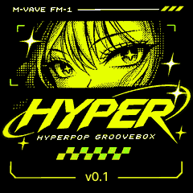
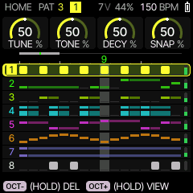
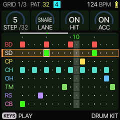
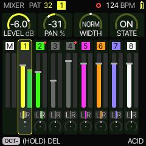
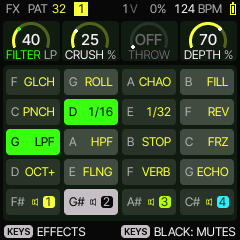

<p align="center"></p>

<h1 align="center">HYPER</h1>

<p align="center">
  A hyperpop groovebox firmware for the M-VAVE FM-1.<br>
  Built on <a href="https://github.com/MPASTEAU/FM-Stud1o-FM-1-Firmware">FM Stud1o</a>, a fork of
  <a href="https://github.com/hugelton/Felucca">Felucca</a>. GPL-3.0-only.
</p>

> **Status: v0.1 beta, not yet run on hardware.** HYPER's new parts are tested on a computer, through the
> firmware's own C sources (see "What's been checked"). The device image is built by GitHub Actions, because the
> FM-1's compiler only downloads on Linux, and no one has flashed this exact build yet. Back up first.
> [docs/INSTALL.md](docs/INSTALL.md) covers installing, going back to the official firmware, and recovery.

| | | | |
|:-:|:-:|:-:|:-:|
| <br>HOME, the factory song playing | <br>the drum grid | <br>MIXER, neon tracks | <br>FX: the HYPER tools |

*(Drawn by the firmware's own drawing code on the computer, `tests/ui_render.c` and `tests/hyper_song_test.c`.)*

## What HYPER adds to FM Stud1o

FM Stud1o already turns the FM-1 into an 8-track, FL Studio-style groovebox: a channel rack, piano roll, drum grid,
song arranger, mixer, an FX chain on every track, per-step chance / ratchet / nudge / conditions, swing, sidechain,
chord keys, 14 synth engines, MIDI and USB audio. Its manual is in [docs/FM-STUD1O.md](docs/FM-STUD1O.md) and
applies to HYPER unchanged. HYPER adds:

### Neon look
- A **HYPER palette** (the default): near-black `#080A0B`, white `#F5F5F5`, neon yellow `#F4FF3A` for values,
  curves and selection, electric green `#39FF14` for the playhead, cursor and sounding steps.
- **Neon track colours**: DRUMS yellow, SUB green, BASS lime `#B6FF00`, CHORDS cyan, LEAD magenta, ARP orange,
  TEXTURE violet, FLEX white.
- A **full-screen boot screen**, showing the installed version. On the FM-1, the art is stored at 80 × 80 and
  drawn 3× (a chunkier pixel look) so the app fits its 581,564-byte slot (see "Fitting the FM-1" below).

### Hyperpop tools: hold FX, then press a white key

| Key | Tool | What it does |
|---|---|---|
| F3 | **GLITCH** | Rhythmic stutter in time: a repeat that switches between 1/16 and 1/32 and drops out dry on a fixed 8-step pattern, so it's the same every time. |
| G3 | **ROLL** | Every DRUM track rolls: a closed hat on every step, played twice (1/32), four times with a rising snare in the bar's last beat. Kicks stay single. |
| A3 | **CHAOS** | Steps vary: drums double, lose hats, open the hat or gain ghost snares; synths jump an octave, double or rest. **KNOB 4 (DEPTH)** sets how much while held (default 50%). Each loop varies the same way every time it comes round, and the downbeat kick is never removed. |
| B3 | **FILL** | Tap it: the current bar's last beat plays a rising snare and tom fill on every DRUM track. Steps marked FILL in SEQ → DETAIL play too. Then it switches itself off. |
| C4 | **PUNCH** | A transient shaper on the master: attacks up to +6 dB louder against their tails, with a soft knee so loud hits never clip hard. |

The other 11 keys keep FM Stud1o's effects (REPEAT 1/16 and 1/32, REVERSE, LPF, HPF, TAPE STOP, FREEZE, OCT UP,
FLANGER, REV and ECHO THROW). To put any effect on any key: hold FX and the key, then turn the PRESETS knob (EDIT
puts back the key's default). **MENU → FX LATCH** makes taps toggle. Nothing is written into your patterns: the tools change the steps only as they play.

### HYPER CHORDS: hold SEQ, then press OCT+
Writes a 4-bar chord progression onto the selected (non-drum) track, in its ROOT, voiced with at most four notes
that move as little as possible between chords. Each press moves to the next mood:

| Mood | Progression |
|---|---|
| EUPHORIC | IVmaj7 V7 iiim7 vim7 (the "royal road") |
| EMOTIONAL | vim7 IVmaj7 Iadd9 Vsus4 |
| DREAMY | Imaj9 iiim7 IVmaj7 ivm7 |
| DARK | im9 bVImaj7 ivm7 V7 |
| NOSTALGIC | Imaj7 vim7 iim7 V7 |
| ENERGETIC | vi IV I V |
| PLAYFUL | Iadd9 III7 IV iv |
| MELANCHOLIC | i bVII bVI V7 |

It sets the track's scale (major or minor), LEN 64 and DIV 1/16, and **replaces that track's pattern**, as CLEAR
does first. Set ROOT on the SCL page beforehand.

**On a DRUM track, the same SEQ + OCT+ writes a factory beat instead.** Each press moves to the next: HYPERPOP,
DANCE-POP, HALF-TIME, ELECTROPOP, DIGICORE, GLITCH. Each is 4 bars with velocities and ratchets set.

### More chords, chord memory (SCL → CHORD, CHRD)
Besides FM Stud1o's DIA3, DIA7, MAJ, MIN, DOM7, MAJ7, MIN7, SUS4, POW, COLOR and MATCH (with voicings CLOSE, OPEN,
INV1, INV2, +OCT and AUTO voice-leading), HYPER adds **SUS2, ADD9, MAJ9, MIN9** and **MEM**: chord memory. Play any
chord once in another mode (MATCH lets you hold the keys of any chord), switch CHRD to MEM, and one finger plays that
chord's shape on every key.

### Pumping without a kick (FX → SIDECHAIN, SRC)
Besides a track (T1–T8), SIDECHAIN's source can be **1/4** or **1/8**, the tempo's own pump: the track ducks on every
beat or eighth while the transport runs. DEPTH sets how deep; REL sets how long (turn it up for the classic long
pump).

### Track roles
When you pick a track, the screen names it by what it plays, for example **T1 DRUMS: HYPER KIT** or
**T2 BASS: SUB BASS**. The role comes from the sound's category, so it follows when you change a track's sound.

### Two hyperpop drum kits (EDIT → DRUM presets)
- **HYPER KIT**: a clipped kick (maximum drive, widest pitch bend), a snappy bright snare, a 7-strike clap, the
  brightest hats, and an impact boom on the BELL lane.
- **808 HYPER**: a long, distorted 808, a trap snare, clicky digital hats, and a glitch blip on BELL.

### The factory song: 8 tracks, 150 BPM, F# major
| Track | Role | Sound |
|---|---|---|
| 1 | DRUMS | DRUM HYPER KIT, 4 patterns: hyperpop, four-on-the-floor, half-time, electropop |
| 2 | SUB | ANALOG SUB BASS: gliding, driven 808 line |
| 3 | BASS | GROWL GRIT: offbeat pump, then rolling 16ths |
| 4 | CHORDS | ANALOG RAVE: held, then stabs (EUPHORIC, then ENERGETIC) |
| 5 | LEAD | TRIO SYNC LEAD: the hook, from the chord tones, sliding |
| 6 | ARP | LOFI ARP 8BIT: 16ths up and down the chord |
| 7 | TEXTURE | GRAIN SHIMMER: held air |
| 8 | FLEX | DRUM 808 HYPER: the 808 boom and glitch clicks |

SUB, BASS, CHORDS and TEXTURE duck on the kicks (sidechain). It's 16 four-bar sections: intro, verse, pre-chorus,
build, drop, break, second verse, drop, outro. In the browser emulator it plays at power-on. On the device, install
it as a project with `tools/fm1_demo_projects.py` (see INSTALL.md); there's no room for it in program memory.

## What's been checked (and what hasn't)

On a computer, through the firmware's C sources (`HOST_ONLY=1 tests/run_tests.sh`):
- **`tests/hyper_test.c`**: tools idle means steps play exactly as stored; ROLL / CHAOS / FILL behave as described,
  repeat deterministically and never touch stored patterns; all 8 moods × 12 roots voice correctly; GLITCH and PUNCH
  are bit-identical when idle, bounded, and fade back to dry; every lane of both kits sounds and rings out; the
  ninth chords and MEM; the tempo pump fires on every beat and is heard.
- **`tests/hyper_song_test.c`**: the factory song boots and plays for 40 s with the tools used over it; then the
  six beats and a mood are written through the real firmware, and the track roles are checked. No clipping,
  no DC, no gaps, no voices shed, no late audio blocks. The emulator's CPU model estimates about 57% at peak (FM
  Stud1o's demo: about 69%). That's an estimate, not a measurement.
- **`tests/ui_render.c`**: every one of 232 screens in all 11 palettes; 0 layout findings.
- FM Stud1o's own suite: no test that passed before HYPER fails now. Some of FM Stud1o's own tests were already
  failing before HYPER's changes; they're listed in the build log.

**Built on the real compiler** (GitHub Actions, JieLi's toolchain): `hyper-0.1.fwsc`, 610,090 bytes, identity
FM-1_901; the app 579,152 of 581,564 bytes. HYPER's tests pass there too.

**Not yet checked:** anything on a real FM-1: sound, CPU load, knobs and keys.

### Fitting the FM-1
FM Stud1o fills nearly all of the FM-1's app memory, and HYPER's additions were 18,876 bytes too many. The build
(`tools/build.py`) shrinks step by step until it fits, and says which step in its log. v0.1 needed every step:
- the boot art stored at 80 × 80 and drawn 3× (16.5 KB → 2.7 KB),
- the USB serial console left out (a developer's tool: the USB MIDI, USB audio and the editor are unaffected),
- the parameter icons on the knob cards left out (the knob names and values stay).

## Where each spec item lives
- **Drums**: per-step velocity / accent (SEQ → DETAIL), chance and FILL conditions, ratchets x1–x4, swing (GLO),
  microtiming (NUDGE), per-step pitch (a parameter lock: hold the step and turn HOME's TUNE knob), pattern
  copy (PATTERN → COPY), editing while it plays, kits and every drum sound edited on EDIT → DESIGN.
- **Bass**: glide, ADSR, cutoff, resonance, drive, distortion, LFO and envelope modulation, detune / unison on the
  synth engines; slides, accents and note lengths per step; sidechain on the kick or the tempo (above).
- **Chords**: key and scale (SCL), one-key chords, sevenths, ninths, sus, add9, inversions and voicings, chord memory
  (MEM), transposition (TRN), the mood generator.
- **Arp, song mode, mixer, FX, saving, MIDI, USB audio**: FM Stud1o's, unchanged (docs/FM-STUD1O.md).

## Known limits of v0.1
- Track names aren't editable: the role shown follows the sound's category. An editable name needs a project-format
  change.
- The bass and chord *engines* are FM Stud1o's (ANALOG, GROWL, TRIO, FM6…). HYPER chooses and sets them up; it
  doesn't add a new synth voice.
- The original spec file arrived cut off partway through the chord generator. What came after it is covered by FM
  Stud1o's existing arp, song mode, mixer, FX and saving.

## Building

```sh
git clone --recurse-submodules <this repository> && cd HYPER
python3 -m pip install Pillow fonttools
HOST_ONLY=1 tests/run_tests.sh           # host tests, any Linux or macOS C compiler (no FM-1 compiler needed)
tools/get_toolchain.sh                   # JieLi's Linux toolchain (Linux x86-64; macOS through Docker)
git clone --depth 1 --branch AC79NN_SDK_V1.2.1_2023-12-13 https://gitee.com/Jieli-Tech/fw-AC79_AIoT_SDK.git ~/fw-AC79_AIoT_SDK
./build.sh --release 0.1                 # build/release-0.1/hyper-0.1.fwsc
```

Or let GitHub build it: [.github/workflows/build.yml](.github/workflows/build.yml) (steps in INSTALL.md).
[BUILDING.md](BUILDING.md) has the build flags.

| File | HYPER's part |
|---|---|
| `firmware/src/hyper.c` | ROLL / CHAOS / FILL on the steps as they play; the mood chord generator |
| `firmware/src/chord.c`, `fx.c`, `ui.c`, `ui_graph_more.c` | SUS2 ADD9 MAJ9 MIN9 MEM; the tempo pump (SRC 1/4 1/8); the track roles |
| `firmware/src/perform.c` | GLITCH and PUNCH; the FX key map |
| `firmware/src/ui_tools.c`, `ui_layer.c` | SEQ + OCT+ writes chords (beats on a DRUM track); the tools' names on the FX map |
| `firmware/src/eng_drum.c` | HYPER KIT, 808 HYPER |
| `firmware/src/main.c` | the factory song (`DAH_DEMO_SONG 2`) |
| `firmware/src/gfx.c`, `ui_draw.c`, `tools/gen_ui_palettes.py`, `tools/gen_splash_image.py` | palette, track colours, boot screen |
| `firmware/hal/fm1_flash_id.h` | the flash chips HYPER saves to (from SLOOP) |
| `tests/hyper_test.c`, `tests/hyper_song_test.c` | HYPER's tests |

## Licence and credits
GPL-3.0-only, like FM Stud1o and Felucca (see [LICENSE](LICENSE), [LICENSING.md](LICENSING.md)). Parts keep their own
licences (the MIT Felucca-Engines, the Apache-2.0 JieLi SDK files the package carries, the CC0 samples), listed there.

- **Felucca** by Leo Kuroshita ([@kurogedelic](https://github.com/kurogedelic)), Hügelton Instruments: the engines,
  hardware layer, loader, storage and tools.
- **FM Stud1o** by MPASTEAU: the 8-track groovebox HYPER is built on.
- **SLOOP** by isod89: the newer flash chip's support.
- The boot art is HYPER's own artwork, supplied by the project's author.

Not affiliated with or supported by M-VAVE, Hügelton Instruments, or the FM Stud1o and SLOOP authors.
