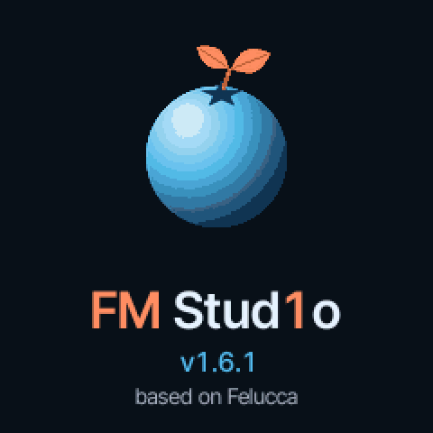
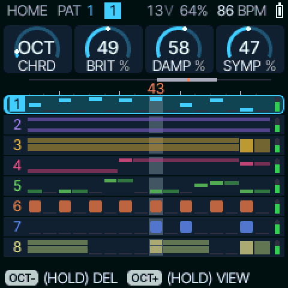
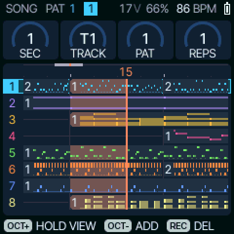
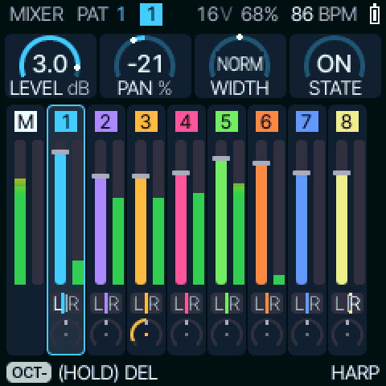
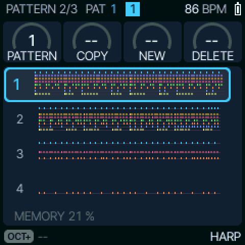
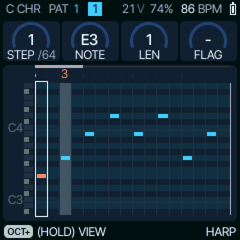
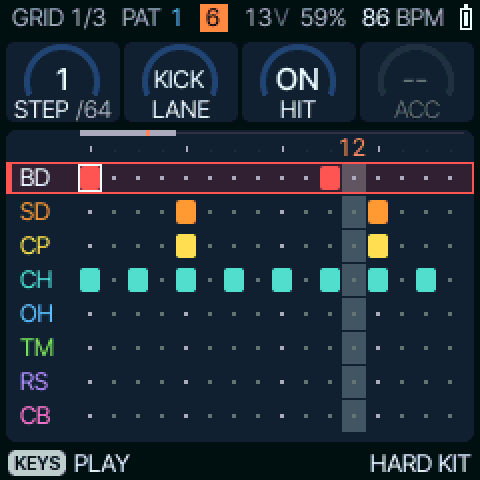
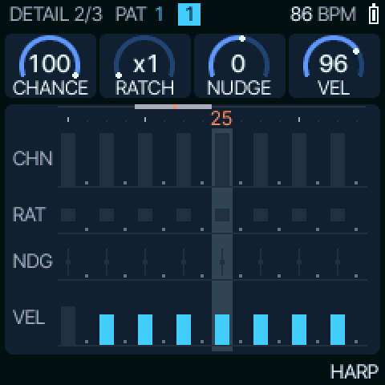
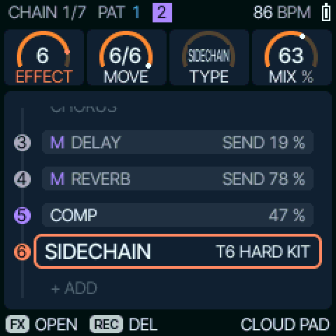

<p align="center">
  
</p>

<h1 align="center">FM Stud1o</h1>

<p align="center">
  An 8-track groovebox firmware for the M-VAVE FM-1, based on Felucca.<br>
  <a href="LICENSE"></a>
</p>

<p align="center">
  
  
</p>

## Screens

All captured from the firmware itself (the browser emulator's build, the TRIP-HOP demo playing on its eight tracks).

| | |
|:---:|:---:|
| <br>**HOME**: the eight tracks as a channel rack, the playhead | <br>**GLO > SONG**, playing: the arrangement, a pattern per track and section, the playhead |
| <br>**MIXER**: levels, pan, meters, the MASTER strip | <br>**PATTERN**: the pattern selector, each one drawn |
| <br>**SEQ > STEP**: the piano roll | <br>**SEQ > GRID**: the drum grid, lane by lane |
| <br>**SEQ > DETAIL**: chance, ratchet, nudge, velocity per step | <br>**FX > CHAIN**: a pad's effects, its sends, its SIDECHAIN on the kick |

FM Stud1o is an alternative firmware for the **M-VAVE FM-1** pocket synthesizer. It turns the FM-1 into an
**8-track groovebox** loosely modelled on FL Studio's workflow: a channel rack of eight tracks, global patterns, a
piano roll and a drum grid, a SONG arranger, a mixer and an FX chain on every track.

It is a fork of [Felucca](https://github.com/hugelton/Felucca) by Leo Kuroshita ([@kurogedelic](https://github.com/kurogedelic)),
[Hügelton Instruments](https://hugelton.com): the synthesis engines, the hardware layer, the update loader, the storage and
most of the tooling are Felucca's. This fork is based on Felucca 1.6.1 (the version string the firmware still reports) and
is not affiliated with or supported by Hügelton Instruments or M-VAVE.

> **At your own risk.** Installing third-party firmware on the FM-1 is not supported by M-VAVE. It can be undone (see
> [Going back to the official firmware](#going-back-to-the-official-firmware)), but if an install is cut off and the
> device no longer starts, recovery needs [FM-1-transporter](https://github.com/kurogedelic/FM-1-transporter).

## Contents

- [Quick start](#quick-start)
- [Hardware and installation](#hardware-and-installation)
- [What the firmware does](#what-the-firmware-does)
  - [Tracks and engines](#tracks-and-engines)
  - [Sequencer](#sequencer)
  - [Patterns and SONG](#patterns-and-song)
  - [Automation and parameter locks](#automation-and-parameter-locks)
  - [Effects](#effects)
  - [Mixer](#mixer)
  - [Projects, saving and presets](#projects-saving-and-presets)
  - [Buttons and held menus](#buttons-and-held-menus)
  - [Performance, CPU and the second core](#performance-cpu-and-the-second-core)
  - [USB, MIDI and the serial console](#usb-midi-and-the-serial-console)
- [Browser emulator](#browser-emulator)
- [Building](#building)
- [Tests](#tests)
- [Tools](#tools)
- [Licence and credits](#licence-and-credits)

## Quick start

```sh
git clone --recurse-submodules https://github.com/MPASTEAU/FM-Stud1o-FM-1-Firmware.git
cd FM-Stud1o-FM-1-Firmware
tools/get_toolchain.sh                         # JieLi toolchain -> ~/.jieli/toolchain
# JieLi AC79 SDK in ~/fw-AC79_AIoT_SDK (see BUILDING.md), Docker running on macOS
./build.sh                                     # -> build/fm-stud1o.fwsc
pip3 install mido python-rtmidi
python3 tools/fm1_install.py build/fm-stud1o.fwsc   # FM-1 connected by USB
```

No hardware? `web/emu/build.sh` builds the same firmware for the browser (see [Browser emulator](#browser-emulator)).

## Hardware and installation

The firmware runs on the M-VAVE FM-1 (JieLi AC79-series chip with two CPU cores, colour screen, 14 buttons, 7 encoders,
27 keys, speaker, USB and TRS MIDI IN). Nothing extra is needed: the FM-1 is updated over its USB-MIDI
connection.

### Installing

`tools/fm1_install.py` performs the same update as M-VAVE's updater: the running firmware starts the update loader,
the loader receives the package over USB-MIDI and writes it, the FM-1 restarts and the installed identity is checked.

```sh
pip3 install mido python-rtmidi
python3 tools/fm1_install.py build/fm-stud1o.fwsc        # asks before writing; --yes skips the question
python3 tools/fm1_install.py --info                    # identity of the connected FM-1
python3 tools/fm1_install.py PACKAGE.fwsc --port NAME  # pick a MIDI port by part of its name
```

The loader only writes the application area; it never touches the region where settings, projects, user presets and
user samples are stored, so **installing or updating keeps your projects**. If an earlier install was interrupted and the
FM-1 is still in update mode, running the installer again finishes the write.

A local copy of the web installer page can also install your own build (`python3 web/make_site.py build/fm-stud1o.fwsc dev
/tmp/site`, served from `localhost`; see [BUILDING.md](BUILDING.md)). The public Felucca web installer installs upstream
Felucca, not FM Stud1o.

### Going back to the official firmware

Either use M-VAVE's own updater, or give the installer the official file:

```sh
python3 tools/fm1_install.py FM-1.fwsc            # the unmodified official V15 package
python3 tools/fm1_install.py FM-1.fwsc --force    # any other package without the Felucca loader marker
```

The unmodified official V15 file is recognised by its SHA-256 and accepted without `--force`; `--force` is needed for
packages the installer does not recognise. No M-VAVE file is included in this repository.

## What the firmware does

### Tracks and engines

- **Up to eight tracks** (synth parts), each with its own engine, sound, envelope, LFO, arpeggiator, scale and chord
  settings, pattern, FX chain and mixer strip. Tracks are added by turning ALGORITHM past the last one and can be
  deleted from HOME or the MIXER (hold OCT- for 0.5 s on the track; stopped only).
- **Up to 8 voices per track**. There is no fixed shared voice budget: if the audio runs out of CPU time, voices are
  shed (faded out) rather than the audio glitching.
- The keys play the selected track. PRESETS browses the engine's sounds, the EDIT pages expose the engine's
  parameters, ENV / LFO (including a drawable LFO shape) / ARP / SCL pages shape the part.

| Engine | What it is |
| --- | --- |
| ANALOG | Two band-limited oscillators (saw, square, triangle, sine, PWM, sync, sub), noise, drive, LP / BP / HP state-variable filter |
| PHASE | Phase-distortion synthesis with wave alternation, a second line (mix / ring), sub, wavefolder |
| LOFI | Chip voice: pulse, triangle, saw, noise and 4-bit wave RAM, stepped envelopes, pitch sweep |
| SAMPLE | Multi-zone IMA ADPCM instrument sets (CC0 samples) and three user slots |
| VOICE | Formant synthesizer (Klatt-style cascade): sung vowels, choir ensemble |
| TRIO | Three oscillators with ring mod and hard sync into a multimode filter, 8-bit home-computer style |
| WHEEL | Tonewheel organ: nine drawbar partials |
| GRAIN | Granular engine over the sample material (tracks 1 and 2 only) |
| PHYS | Physical models ported from DaisySP and Rings: modal, strings, resonator, sympathetic strings (tracks 1 and 2 only) |
| DRUM | 8-lane drum kit (KICK, SNARE, CLAP, HAT CL, HAT OP, TOM, RIM, BELL) with a per-lane designer and layered SYN TONE / NOISE / METAL voices |
| NOISE | Analog-style, dust and shift-register noise through a resonant filter |
| FM6 | Six-operator FM (msfa port): 32 algorithms, per-operator pages |
| SLICE | Sample slicer over the built-in BREAK, PIANO or a user slot, with manual slices |
| GROWL | One wave phase-modulated by a sine into a resonant low-pass, for growling FM basses (this fork's) |

DIGITAL (Felucca's retired 4-operator FM) is not built by default; its sounds load as FM6.

### Sequencer

Each track has a pattern of up to **256 steps** (LEN, in four pages of 64), with its own DIV (step length), SWING, GATE
and QUANTIZE.

- **Piano roll** (SEQ > STEP) for melodic tracks; a **DRUM grid** of eight lanes for DRUM tracks. The cursor step can
  be edited with the knobs; STEP PREVIEW plays what is placed.
- **Step recording**: REC while stopped arms the track; the keys then write notes on the cursor step (CHORD ENTRY ADD
  by default: keys add notes to the step). On the DRUM grid, the keys become the steps while armed and play the kit
  otherwise.
- **Live recording**: armed and playing, the keys record into the pattern with their timing (NUDGE). Options in REC's
  held menu:
  - **REC MODE**: OVERDUB (default, notes are added) or REPLACE (the first note of a new pass wipes the previous take).
  - **LOOP CUE** (on by default): three descending blips on the last beats of the loop and a ping on step 1 while
    armed, so you know when the loop comes round.
  - **COUNT-IN**, **CLICK** (OFF / REC / ON) and its LEVEL, **REC STARTS PLAY**.
- **Notes**: up to four notes per step; on POLY tracks each note has its own length, so **overlapping notes** and
  per-note ties work (a note held while another starts keeps sounding). Steps carry **velocity**, **accent** and
  **slide** (drawn as a bend into the next note on the roll).
- **Timing**: per-step **NUDGE** (1/16 of a step, half a step early to 7/16 late); **QUANTIZE** OFF (as played, the
  default), 25 / 50 / 75 % or ON (on the grid).
- **Per-step DETAIL**: **CHANCE** (0–100 %), **CONDITIONS** (1:2, 2:2, 1:3 … 4:4, FILL, !FILL — FILL while GLO + E4
  is held), **RATCHET** ×1–×4, velocity.
- The sequence can drive a track's arpeggiator, and **chord keys** (DIA3, DIA7, MAJ, MIN, DOM7, MAJ7, MIN7, SUS4, POW,
  COLOR, MATCH, with voicings) let one key play a chord.

### Patterns and SONG

- **Patterns are global, as in FL Studio**: a pattern number covers every track. Up to 32 patterns per track; GLO +
  ALGORITHM (or SELECT, on pages without a list) moves to the previous / next pattern, past the last one creates a new one (empty or a copy).
  SAVE > PATTERN opens, copies, creates and deletes them. A track can also be set to play no pattern.
- **SONG** (tap GLO) arranges the song as a timeline of up to 16 **sections**. Each section names the pattern every
  track plays there (one lane per track, or silent) and a number of repeats; a section can be marked CUT (FX tails
  cleared, a dry drop). Each block is drawn as a small picture of its pattern.
- The **GRID** position is where PLAY and RESTART (GLO + PLAY) start; picking a section moves it there. While playing,
  moving the GRID makes the song jump.

### Automation and parameter locks

- **Automation**: knob moves of the selected track are recorded while it is armed and playing (also from the editor
  and MIDI CC). SEQ > AUTOMATION shows HOME's four knobs as four lanes of curves and points over the steps, with ramps.
- **Parameter locks**: hold a step and turn HOME's four knobs; the value applies to that step only.

### Effects

Each track has an FX chain (FX > CHAIN: add, move, change type and mix of each effect; up to eight):

| Effect | |
| --- | --- |
| DIST | Distortion: IN, DRIVE, COLOR, OUT |
| INSERT | SOFT, HARD, FOLD, FUZZ, CRUSH, PHASER, FLANGER, CHORUS, with MIX |
| SLICER | Tempo-synced GATE / STUTTER |
| EQ | BASS and TREBLE shelves (−15 to +15 dB, adjustable corner), bypassed when flat |
| COMP | Compressor: AMOUNT, RELEASE, IN / OUT gain |
| SIDECHAIN | Ducks the track from one or two source tracks (DRUM sources pump on their kick, snare …): SOURCE, DEPTH, RELEASE |
| CHORUS / DELAY / REVERB | Sends to three shared buses; DELAY tempo-synced with feedback and colour, REVERB ROOM / SPRING / HALL |

The **MASTER** (left of track 1 in the MIXER, or ALGORITHM before track 1) has its own chain: the bus returns, DIST, a
**4-band EQ** (high / low cut 6 / 12 / 24 dB, low / high shelf, bell) and a compressor.

Holding **FX** opens performance effects on the keys (REPEAT 1/8 / 1/16 / 1/32, REVERSE, LPF, HPF, TAPE STOP, FREEZE,
OCT UP / DN, FLANGER, PHASER, REV THROW, ECHO THROW), assignable per key.

### Mixer

HOME tapped again opens the **MIXER**: a strip per track (fader and meter, PAN, WIDTH, REVERB send) plus the MASTER.
**MUTE and SOLO take a track out completely**: its output and sends ramp to zero, then it stops rendering (no voices,
no chain, no CPU cost); its steps keep running, so it comes back in time.

### Projects, saving and presets

- **One project = one song**: tracks, sounds, patterns, SONG, automation, FX and mixer. Projects are compressed and
  stored in flash, as many as fit; MENU > RESTORE LAST brings the last session back at power-on.
- **SAVE > FILE**: the project list — OPEN, COPY, NEW; hold OCT- to delete.
- **Quick save**: hold SAVE (0.7 s) to save the open project over itself (a new project with its NAME page if none is
  open). Saving needs the transport stopped (a flash write interrupts audio).
- **SAVE > MY PRESETS**: 32 user preset slots (a track's sound).
- **Factory reset**: MENU > SYSTEM > FACTORY RESET erases settings, projects, user presets and the FM6 bank (user
  samples are kept) and restarts. Hold OCT- in the GLO / REC / SEQ / MENU layers to reset only their settings.

### Buttons and held menus

Tapping a page button opens its page; holding it opens a quick menu over the current page (double-tap locks it open):

| Held | What it gives |
| --- | --- |
| HOME (MENU) | Settings in five tabs: DISPLAY, CONTROL, AUDIO, MIDI, SYSTEM (2ND CORE, CALIBRATION, INFO, ABOUT, FACTORY RESET) |
| GLO | TEMPO, SWING, TUNE, CLOCK (INT / USB / TRS), MIDI LEARN; keys: D4 MIDI LEARN, E4 FILL (held), F4 TAP tempo |
| REC | CLICK, COUNT-IN, LEVEL, REC STARTS PLAY, LOOP CUE, REC MODE |
| SEQ | LEN, DIV, QUANTIZE, CLEAR TRACK, CLEAR PATTERN |
| SCL | Root, scale (16 scales), chord type and voicing |
| EDIT | Engine selection on the keys, INIT / CLEAN INIT, engine quick actions (e.g. DRUM lane mutes) |
| FX | Performance effects (see above) |

KNOB 1 picks the row, KNOB 2 changes its value. Holding OCT- and OCT+ at power-on runs the panel calibration.

### Performance, CPU and the second core

- The FM-1's chip has two cores. With **MENU > SYSTEM > 2ND CORE ON** (the default) part of the tracks' rendering is
  split onto the second core, balanced by each track's measured cost. It can be turned OFF (one core, as
  Felucca 1.6).
- The header shows the voices sounding and the audio **CPU %** (accent above 85 %). It **blinks red for about 2 s**
  whenever an audio block was late or a voice was shed.
- Effects at rest (reverb tails ended, flat EQs, empty delays) are skipped, and muted tracks cost nothing.

### USB, MIDI and the serial console

- USB: MIDI (in / out, clock, the editor protocol, updates), **USB audio input** (the master output to the computer,
  stereo 44.1 / 48 kHz) and a **USB serial console**.
- MIDI IN over USB and TRS: channels 1–8 to tracks 1–8 (or other routings), clock sync, MIDI learn, program change.
- **Serial console** (any terminal on the FM-1's CDC port, read-only diagnostics): `status` (version, how the second
  core started, …), `prof` (each audio stage's average and worst cost per 2.9 ms block: events, each part's render,
  its chain, buses, MASTER, output), `dbg`, `inp`, `crash`, `params`, `memr`, `flr`, `uboot yes`. MENU > USB SERIAL
  removes it from USB.

## Browser emulator

`web/emu/` compiles the firmware's own sources to WebAssembly against a simulated FM-1 (keys, knobs, screen, audio in
an AudioWorklet), so FM Stud1o can be tried without a device. It powers on with a demo song, keeps its flash (projects,
presets, settings) in the browser, can map MIDI notes / CCs to the panel's buttons, has a Factory reset button, and
shows a CPU estimate derived from measurements on the FM-1. USB, TRS MIDI and user sample slots are not emulated.

```sh
./build.sh                                   # once: the generated tables, fonts and samples in build/gen
web/emu/build.sh                             # needs Emscripten (emcc)
python3 -m http.server -d build/emu 8790     # open http://localhost:8790/
```

## Building

The build needs Python 3 with Pillow and fontTools, the JieLi Linux toolchain (`tools/get_toolchain.sh`), the JieLi AC79
SDK (three of its boot / config files go into the package) and, on macOS, Docker (the toolchain is Linux x86-64 only and
runs in a `linux/amd64` container). Full instructions: [BUILDING.md](BUILDING.md).

```sh
./build.sh                      # build/fm-stud1o.bin, build/loader/ota.bin, build/fm-stud1o.fwsc
./build.sh --release 1.0        # release build and folder build/release-1.0/
```

`JIELI_TOOLCHAIN` and `AC79_SDK` override the default locations. Build options are environment variables read by
`tools/build.py` (`FELUCCA_CPU2`, `FELUCCA_DEMO`, `FELUCCA_CDC`, `FELUCCA_UAC`, `FELUCCA_SLICE`, …; table in BUILDING.md).
`FELUCCA_FAST` is **experimental** and off by default: it runs chosen functions from RAM instead of flash; it measured
faster but faulted about every two minutes with both cores running.

## Tests

```sh
tests/run_tests.sh              # after ./build.sh; AC79_SDK set as for the build
```

Host tests of the real sources (no hardware): golden-render regression of every engine and preset, CPU budgets, flash
storage and every project format, the sequencer (long patterns, overlapping notes, REC modes, track deletion, SOLO /
MUTE), FX, the second core's split, MIDI, the installer, and the UI. `tests/ui_render.c` renders every screen in every
palette from the real drawing code and lints it (text off screen, clipped or overlapping, misaligned by a pixel); PNGs
land in `build/ui_new/`. With Node.js the web page tests run too, and with Emscripten the emulator's.

## Tools

| Tool | |
| --- | --- |
| `tools/build.py` (`./build.sh`) | Builds the app, the update loader and the `.fwsc` package |
| `tools/fm1_install.py` | Installs a package over USB-MIDI; `--info` identifies the device |
| `tools/fm1_demo_projects.py` | `--build`: renders the demo song (TRIP-HOP) as a project and verifies it; `--send`: writes it to the FM-1 (**replaces every project on the device**) |
| `tools/fm1_sample_upload.py` | Loads WAV files into user sample slots USR1–USR3 |
| `web/editor.html` | Felucca's Web MIDI editor, extended to eight tracks |

## Licence and credits

FM Stud1o is free software under the [GNU General Public License, version 3 only](LICENSE) (`GPL-3.0-only`), as Felucca
is. If you distribute it, or firmware built from it, you must give recipients the complete corresponding source under the
same licence.

- **Felucca** is by Leo Kuroshita ([@kurogedelic](https://github.com/kurogedelic)), Hügelton Instruments; files keep
  their original copyright notices. Copyright (C) 2026 Leo Kuroshita, Hügelton Instruments.
- The ANALOG, LOFI, TRIO, WHEEL and NOISE engines, the engine interface and the shared DSP in `firmware/engines/` are
  **MIT**-licensed ([Felucca-Engines](https://github.com/hugelton/Felucca-Engines), a git submodule;
  [LICENSES/MIT-Felucca-Engines.txt](LICENSES/MIT-Felucca-Engines.txt)). Clone with `--recurse-submodules` and include
  it when you share the source.
- Ported DSP keeps its licence: DaisySP and Rings (MIT, PHYS), msfa (Apache-2.0, FM6). Fonts: Inter Tight and
  DotGothic16 (SIL OFL 1.1), Fukiai icons (MIT). Licence texts are in [LICENSES/](LICENSES/); details in
  [LICENSING.md](LICENSING.md).
- The Hügelton Sample Pack (the drum sounds, `tools/gen_waves.py`) is CC0 1.0; the instrument samples in
  `assets/samples-cc0/` (Versilian Studios VSCO-2 CE, VCSL) are CC0 1.0 ([ATTRIBUTION.txt](assets/samples-cc0/ATTRIBUTION.txt)).
- Packages contain three unmodified JieLi AC79 SDK files (Apache-2.0); none are in this tree.
- The second core and the browser emulator build on X0X by charlesvestal, Melodee by keremimo and Jangada by zednaked
  (GPL-3.0). Everyone credited: [CREDITS.md](CREDITS.md).

"M-VAVE" and "FM-1" are trademarks of their respective owners; "Felucca" and "Hügelton Instruments" are names of
Hügelton Instruments; "FL Studio" is a trademark of Image-Line. FM Stud1o is an independent project, not affiliated with
or endorsed by any of them. The firmware never enables the FM-1's Bluetooth / Wi-Fi radio.
